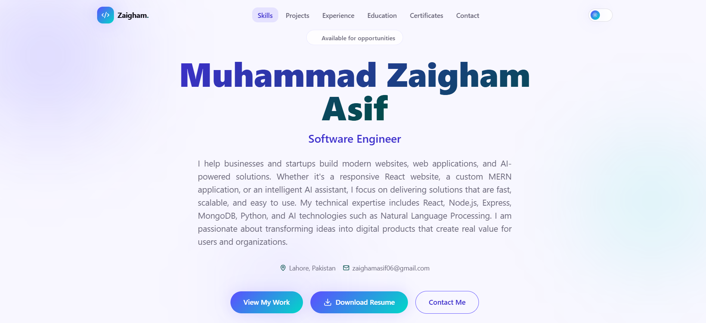

<div align="center">

# Muhammad Zaigham Asif — Developer Portfolio

A fast, accessible, responsive portfolio built with React, TypeScript and Vite.

[**Live site**](https://muhammadzaighamasif.vercel.app/)

<a href="https://muhammadzaighamasif.vercel.app/">
  
</a>

</div>

---

## Features

- Responsive layout with light / dark themes (follows system preference, remembers choice, no flash on load)
- Sections for skills, projects, experience, education, certificates and a contact form
- Dedicated `/projects` page with category filtering (lazy-loaded)
- In-page document viewer for offer letters and certificates
- Contact form delivered through EmailJS (with a honeypot against bots)
- GSAP scroll/entrance animations that respect `prefers-reduced-motion`
- Accessibility: skip link, visible keyboard focus, labelled controls, dialog semantics, ARIA state on the mobile menu
- SEO: Open Graph / Twitter cards, JSON-LD structured data, sitemap and robots.txt

## Tech stack

| Area | Tools |
| --- | --- |
| Framework | React 19, TypeScript, React Router 7 |
| Build | Vite 7 |
| Styling | Tailwind CSS 3 + CSS custom properties |
| Motion | GSAP + ScrollTrigger |
| Forms / email | EmailJS |
| Hosting | Vercel |

## Getting started

Requires **Node.js 20.19+** and npm.

```bash
git clone https://github.com/MuhammadZaighamAsif/Portfolio.git
cd Portfolio
npm install
cp .env.example .env     # then fill in the values (see below)
npm run dev
```

### Environment variables

| Variable | Purpose |
| --- | --- |
| `VITE_EMAILJS_SERVICE_ID` | EmailJS service ID |
| `VITE_EMAILJS_TEMPLATE_ID` | EmailJS template ID |
| `VITE_EMAILJS_PUBLIC_KEY` | EmailJS public key |
| `VITE_ENTER_ANALYTICS_*` | Optional analytics configuration |

If the EmailJS variables are missing, the contact form shows a friendly message pointing visitors to the email address instead of failing silently. The template should use these parameters: `user_name`, `user_email`, `subject`, `message`.

> `VITE_*` values are embedded in the client bundle. EmailJS public keys are designed for that, but never put private secrets in these variables.

## Scripts

| Command | Description |
| --- | --- |
| `npm run dev` | Start the dev server |
| `npm run build` | Type-check, then create a production build in `dist/` |
| `npm run preview` | Serve the production build locally |
| `npm run lint` | Run ESLint (type-aware) |
| `npm run typecheck` | Run the TypeScript compiler without emitting |
| `npm run check` | Lint + type-check (run this before committing) |

## Project structure

```
src/
  components/
    portfolio/   Page sections (Hero, Skills, Projects, Experience, ...)
    ui/          Shared UI primitives (toasts, tooltip, text effects)
  data/          All site content (typed) — edit portfolio.ts to update copy
  hooks/         useTheme, useScrollSpy, usePageMeta, toast
  lib/           Small utilities (motion helpers, achievement toast)
  pages/         Route components (Index, ProjectsPage, NotFound, RouteError)
  router.tsx     Route table (the projects page is code-split)
public/          Static assets: resume, documents, favicon, robots.txt, sitemap.xml
```

## Updating content

Everything shown on the site (bio, skills, projects, experience, education, certificates) lives in [`src/data/portfolio.ts`](src/data/portfolio.ts) and is typed, so the compiler catches missing or misspelled fields. Documents shown in the experience viewer are mapped in `src/components/portfolio/Experience.tsx`.

## Deployment

The site is deployed on Vercel. [`vercel.json`](vercel.json) provides the SPA rewrite (so deep links such as `/projects` work on refresh), security headers and long-term caching for hashed assets. Set the `VITE_EMAILJS_*` variables in the Vercel project settings.

## Contact

**Muhammad Zaigham Asif** — [zaighamasif06@gmail.com](mailto:zaighamasif06@gmail.com) · [LinkedIn](https://linkedin.com/in/zaigham-asif-5a5499240) · [GitHub](https://github.com/MuhammadZaighamAsif)
